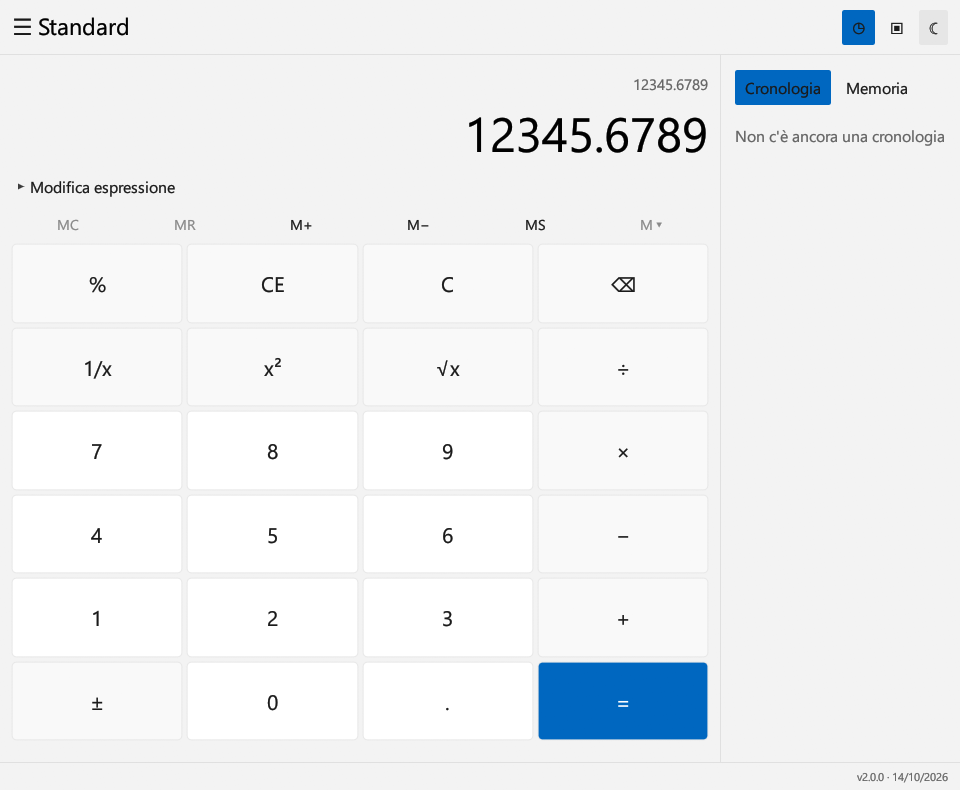
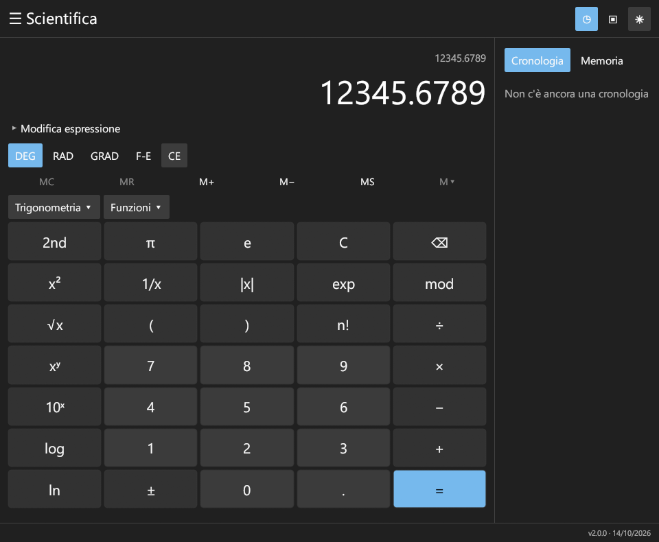

# CalcRUST

[](https://github.com/gmy77/CalcRUST/actions/workflows/ci.yml)

Calcolatrice desktop per Windows, scritta in Rust. **Versione 2.0.0 · 14 ottobre 2026.**

Interfaccia ispirata alla Calcolatrice Microsoft, con temi chiaro, scuro e di sistema. Non è un prodotto Microsoft.

## Avvio

Scarica **Calcolatrice.exe** oppure il pacchetto Windows dalla [release v2.0.0](https://github.com/gmy77/CalcRUST/releases/tag/v2.0.0), poi avvia l'EXE con un doppio clic. Rust serve per compilare il sorgente, non per utilizzare l'eseguibile.

| Tema chiaro | Tema scuro |
| --- | --- |
|  |  |

### Compilazione da sorgente

Occorrono Windows x64, Rust stabile con target MSVC e i Microsoft C++ Build Tools con Windows SDK. L'interfaccia usa OpenGL tramite il driver grafico installato.

```powershell
git clone https://github.com/gmy77/CalcRUST.git
cd CalcRUST
cargo run --release --locked
```

Per generare soltanto l'EXE:

```powershell
cargo build --release --locked
```

Il risultato è `target\release\wincalc-rust.exe`. Il progetto usa librerie Rust per la finestra nativa (eframe/egui), i grafici, il calendario e HTTPS; il codice applicativo è tutto in Rust, senza HTML, JavaScript, Python o WebView.

## Funzioni

- Standard: quattro operazioni in sequenza, percentuali contestuali, CE distinto da C, cambio segno, inverso, quadrato, radice, ripetizione di uguale.
- Scientifica: precedenze, parentesi, potenze e radici, logaritmi anche con base variabile, fattoriale, π/e, DEG/RAD/GRAD, trigonometria diretta/inversa/iperbolica, secante/cosecante/cotangente, arrotondamenti, DMS e numero casuale.
- Programmatore: HEX/DEC/OCT/BIN, BYTE/WORD/DWORD/QWORD, interi esatti fino a 64 bit, AND/OR/XOR/NAND/NOR/NOT, shift logici e aritmetici, rotazioni con e senza carry, modifica di ciascun bit e memoria intera.
- Grafica: più funzioni e variabili a/b, equazioni implicite e disequazioni, zoom, spostamento e zeri stimati nell'intervallo scelto. Esempi: `sin(x)`, `y=a*x+b`, `x^2+y^2=9`, `y<x^2`.
- Date: differenza tra date, totale giorni, aggiunta/sottrazione di anni, mesi e giorni; gestione dei bisestili e del fine mese.
- Tredici convertitori: valuta, volume, lunghezza, massa, temperatura, energia, area, velocità, tempo, potenza, dati, pressione e angolo. Le unità SI e IEC dei dati sono distinte.
- Valute: aggiornamento HTTPS dalla BCE, data esplicita, cache locale e segnalazione dei dati obsoleti o dell'aggiornamento fallito. Non sono quotazioni di transazione.
- Memoria multipla, cronologia richiamabile, copia/incolla, finestra sempre in primo piano, interfaccia adattabile, impostazioni persistenti e indicatore versione/data.

## Tastiera

Invio: risultato. Esc: C. Canc: CE. Backspace: cancellazione. Sono disponibili cifre, operatori, punto/virgola decimale e parentesi. L'editor “Modifica espressione” permette di scrivere anche funzioni come `root(27,3)` o `logy(8,2)`.

Alt+1/2/3/4/5: Standard / Scientifica / Grafica / Programmatore / Date. Ctrl+M/R/P/Q/L: MS / MR / M+ / M− / MC. Ctrl+Shift+D cancella la cronologia. F5/F6/F7/F8 selezionano HEX/DEC/OCT/BIN; F12 seleziona BYTE.

## Precisione e differenze dall'originale

La copertura delle modalità non equivale a identità numerica o grafica completa con Microsoft Calculator. Le operazioni razionali su decimali, frazioni e interi grandi usano BigRational/BigInt: `0.1+0.2` e le catene con frazioni conservano il valore esatto, anche in memoria. Il display arrotonda a 32 posti decimali. Il motore limita esponenti, dimensione dei numeri e fattoriali per mantenere l'interfaccia utilizzabile. Trigonometria, radici non razionali, logaritmi e grafici usano f64 (circa 15 cifre significative), quindi non hanno tutta la precisione dell'originale. Il Programmatore mantiene tutti i 64 bit; overflow e troncamenti seguono la dimensione scelta.

I grafici sono campionati: zeri, contorni e intervalli visualizzati sono stime. Non includono un sistema simbolico completo, derivate/integrali simbolici o tutte le analisi avanzate del motore Microsoft. La regione di una disequazione è tratteggiata numericamente. Unità e copertura valutaria possono differire dall'originale; Mach indica esplicitamente la condizione di riferimento.

Tema, cronologia, memoria e cambi sono salvati da eframe nella cartella dati dell'app dell'utente. I grafici e i dati inseriti non vengono inviati alla rete: l'unica richiesta applicativa prevista è l'aggiornamento BCE richiesto dal convertitore valuta.

## Verifica

```powershell
cargo test --locked
```

La suite comprende 13 test offline e un controllo BCE live separato, escluso dalla CI per evitare dipendenze dalla disponibilità della rete:

```powershell
cargo fmt --check
cargo test --locked live_ecb -- --ignored --nocapture
```

Le verifiche e i limiti del rilascio sono descritti in [docs/VERIFICA.md](docs/VERIFICA.md). Le licenze delle dipendenze distribuite sono raccolte in [THIRD-PARTY-LICENSES](THIRD-PARTY-LICENSES); vedere anche [THIRD-PARTY-NOTICES.md](THIRD-PARTY-NOTICES.md).

## Struttura del progetto

- `src/main.rs`: avvio della finestra nativa.
- `src/ui.rs`: interfaccia, temi, tastiera, memoria, cronologia e persistenza.
- `src/engine.rs`: espressioni matematiche e motore intero del Programmatore.
- `src/precise.rs`: aritmetica razionale esatta e formattazione.
- `src/converters.rs`: unità, cambi BCE e calendario.
- `src/graphs.rs`: grafici espliciti, impliciti e disequazioni campionate.

Non vengono distribuiti codice, binari, font o asset della Calcolatrice Microsoft. I font Segoe vengono letti dall'installazione Windows dell'utente quando disponibili; in alternativa sono usati i font inclusi nelle dipendenze grafiche.
